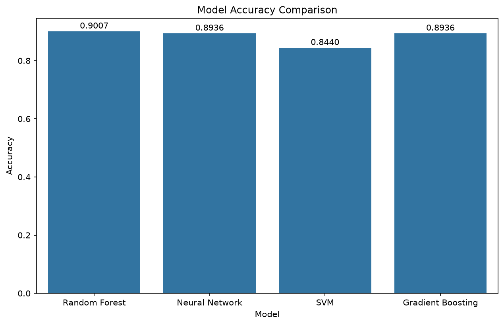
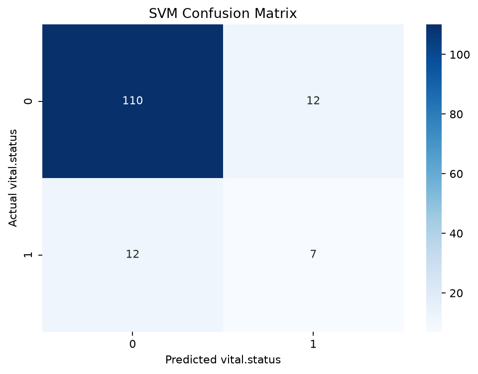
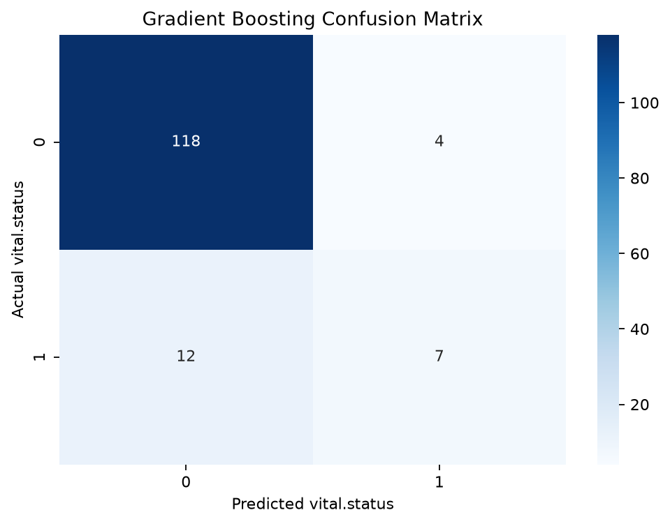
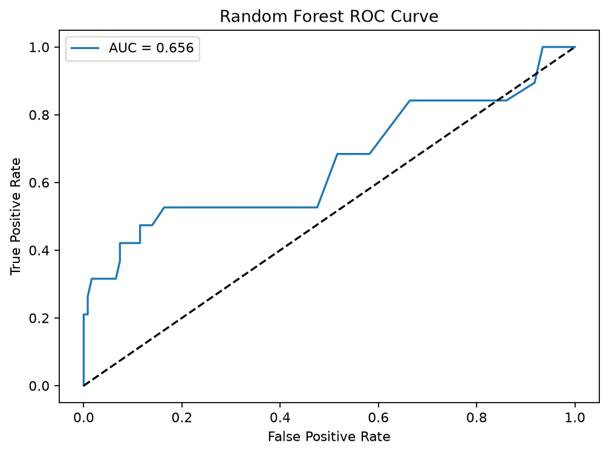
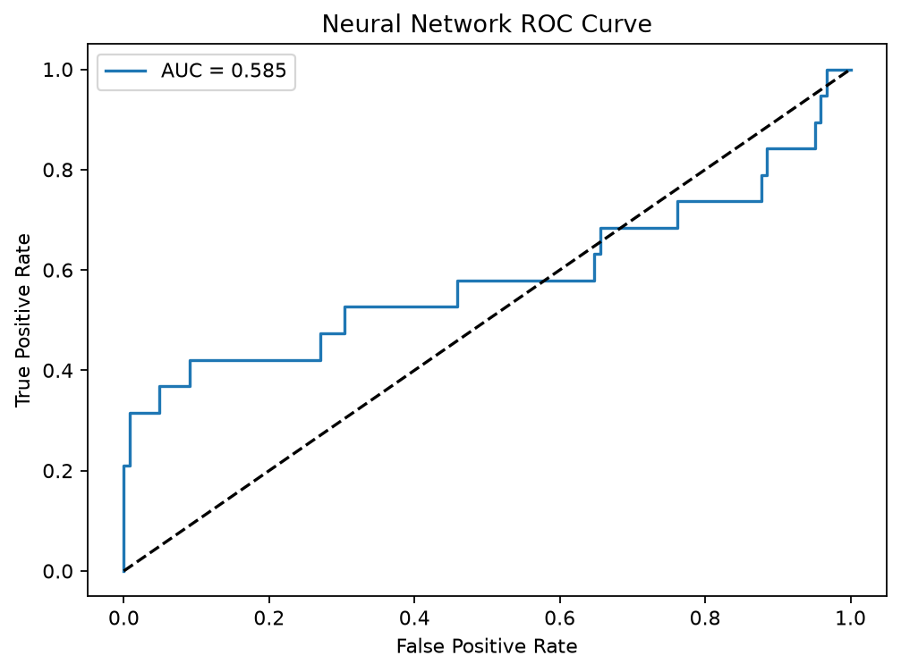
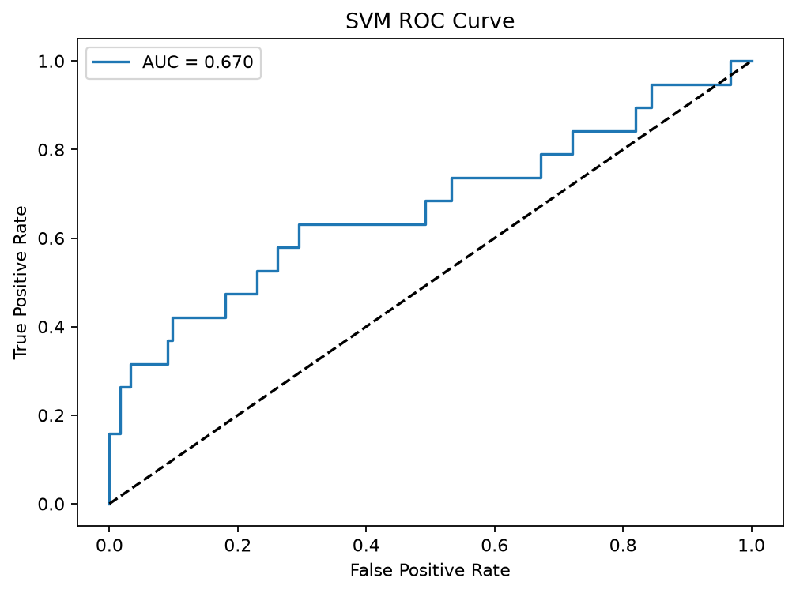
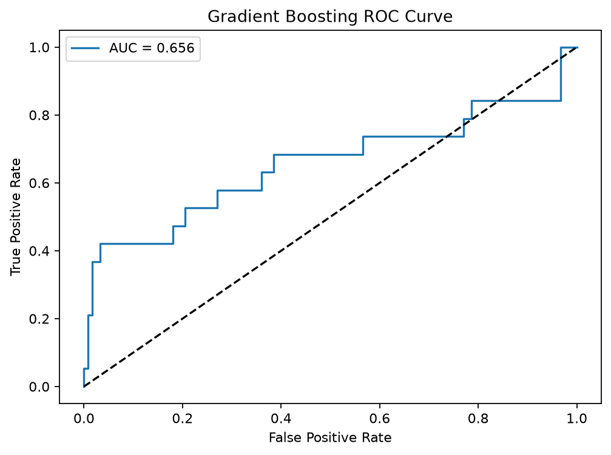

# Breast Cancer Multi-Omics Survival Classification

An MSc Bioinformatics thesis project.

> **Research and educational use only.** This is a retrospective machine-learning
> exercise on a supplied dataset. It is not a diagnostic or prognostic medical
> device and must not be used to make decisions about patient care.

## Project overview

The thesis, *Development of a Machine Learning-Based Diagnostic Tool for Early
Detection of Breast Cancer using Multi-Omics Data Integration*, investigates
whether molecular features can help classify breast-cancer patient outcomes.
The supplied analysis file, however, predicts the `vital.status` outcome (0/1);
it does **not** classify cancer versus non-cancer or establish early detection.
Keep this distinction in mind when interpreting the thesis title and the
results.

The repository contains the submitted thesis, its supplied tabular dataset, a
Python implementation of four classifiers, and reproducible result tables and
figures. `BRCA.py` is the executable analysis; the thesis describes a broader
research plan and findings than this script implements.

## Repository contents

| Path | Description |
| --- | --- |
| `thesis.docx` | Submitted MSc thesis document |
| `data.csv` | Supplied feature matrix and `vital.status` labels |
| `BRCA.py` | Preprocessing, train/test split, model fitting, evaluation and figure generation |
| `requirements.txt` | Python dependencies |
| `results/model_metrics.csv` | Reproduced evaluation metrics for each classifier |
| `results/model_accuracy_comparison.png` | Accuracy comparison across classifiers |
| `results/*_confusion_matrix.png` | Per-classifier confusion matrices |
| `results/*_roc_curve.png` | Per-classifier ROC curves |

## Dataset

The supplied CSV contains **705 samples**, **1,936 feature columns**, and one
target column (`vital.status`), for 1,937 columns total. The target has two
values:

| `vital.status` | Samples | Proportion |
| --- | ---: | ---: |
| 0 | 611 | 86.7% |
| 1 | 94 | 13.3% |

The feature column prefixes in this file are `rs_` (604 features), `cn_` (860),
`mu_` (249), and `pp_` (223). The CSV does not include a data dictionary that
defines these prefixes or identifies the exact source cohort/accession. The
thesis discusses public repositories including TCGA and GEO, but the supplied
files alone do not establish a precise data provenance or sample-level
permissions. Confirm provenance, reuse terms, and any disclosure/privacy
requirements before redistributing the dataset.

The dataset has no blank cells in the supplied version. The script retains a
`dropna()` step as a basic safeguard, then treats every column except
`vital.status` as a model feature.

## Analysis workflow

`BRCA.py` performs the following steps:

1. Loads `data.csv` and removes rows with missing values.
2. Separates all remaining columns into predictors and the `vital.status`
   target.
3. Creates a stratified 80/20 train/test split with random seed 42. This gives
   564 training samples and 141 held-out test samples, including 19 class-1
   samples in the test set.
4. Fits `StandardScaler` using **training data only**, then applies that fitted
   scaler to the training and test matrices. This avoids leaking test-set
   distribution information into preprocessing.
5. Fits four classifiers with the settings shown in `BRCA.py`:
   - Random Forest (100 trees)
   - Neural Network / MLP (one hidden layer with 100 units; maximum 500
     iterations)
   - Linear Support Vector Machine
   - Gradient Boosting (100 estimators)
6. Reports accuracy, per-class precision/recall/F1, and confusion matrices;
   calculates ROC-AUC from predicted probabilities or decision scores.
7. Writes the metric table and PNG figures to `results/`.

The positive class used for class-1 metrics and ROC analysis is
`vital.status = 1`. The script does not perform the thesis-described LASSO or
statistical feature selection, hyperparameter search, cross-validation,
independent cohort validation, or a separate multi-omics integration
algorithm. The four feature prefixes are simply passed together as model
inputs.

## Reproduced results

The following table is generated by the current `BRCA.py` run. Accuracy alone
is not a sufficient measure here: the dataset is imbalanced, so the recall and
F1-score for class 1 are particularly important.

| Model | Accuracy | Class-1 precision | Class-1 recall | Class-1 F1 | ROC-AUC |
| --- | ---: | ---: | ---: | ---: | ---: |
| Random Forest | 0.9007 | 1.0000 | 0.2105 | 0.3478 | 0.6564 |
| Neural Network | 0.8794 | 0.6000 | 0.3158 | 0.4138 | 0.5846 |
| SVM | 0.8298 | 0.3684 | 0.3684 | 0.3684 | 0.6700 |
| Gradient Boosting | 0.8865 | 0.6364 | 0.3684 | 0.4667 | 0.6562 |

Random Forest has the highest accuracy on this split, while Gradient Boosting
has the highest class-1 F1-score and SVM has the highest ROC-AUC. All models
miss a substantial share of class-1 cases: their class-1 recall ranges from
0.21 to 0.37. These single-split results are exploratory and do not demonstrate
clinical utility or reliable generalization.

### Accuracy comparison



### Confusion matrices

| Random Forest | Neural Network |
| --- | --- |
|  |  |

| SVM | Gradient Boosting |
| --- | --- |
|  |  |

### ROC curves

| Random Forest | Neural Network |
| --- | --- |
|  |  |

| SVM | Gradient Boosting |
| --- | --- |
|  |  |

## Results stated in the thesis

The thesis reports these test accuracies: Random Forest **90.07%**, Neural
Network **89.36%**, SVM **84.39%**, and Gradient Boosting **89.36%**. It also
describes ROC-AUC values of approximately 0.50 (Random Forest), 0.57 (Neural
Network), 0.59 (SVM), and 0.56 (Gradient Boosting). Those are thesis-reported
values, not the current run's outputs.

The original script was run before this repository's reproducibility updates
and produced the reported accuracies. The current script deliberately fits
scaling on the training set only and uses a stratified split; its scores
therefore differ and should not be presented as a byte-for-byte reproduction
of the old evaluation. See `results/model_metrics.csv` for the current run.

## Interpretation and limitations

- **Outcome and title differ:** the executable predicts the recorded
  `vital.status`, not early cancer diagnosis. This is an outcome-classification
  analysis, not evidence of a screening or diagnostic tool.
- **Class imbalance:** only about 13% of records have label 1. Accuracy is
  dominated by the majority class; the low class-1 recall means many positive
  cases are missed.
- **High dimensionality:** 1,936 input features are evaluated with 705
  samples. This creates substantial overfitting risk, especially without
  nested validation or feature selection performed entirely inside each
  training fold.
- **Limited validation:** the reported evaluation uses one random hold-out
  split. There is no cross-validation or independent external cohort in the
  executable analysis.
- **No feature selection in code:** although the thesis discusses biomarkers
  and selection methods, `BRCA.py` does not implement the statistical tests,
  LASSO selection, or an interpretable feature-importance analysis. Biomarker
  and pathway claims in the thesis are not independently reproduced by this
  script.
- **No clinical validation:** no calibration assessment, decision analysis,
  prospective validation, or assessment of clinical consequences is included.
- **Data provenance:** source accession, cohort details, and a feature
  dictionary are not present alongside the supplied CSV.

These limitations mean that the reported performance should be treated as
exploratory research only.

## Run the analysis

Use Python 3.10 or newer. From the repository root:

```bash
python -m venv .venv
source .venv/bin/activate
python -m pip install -r requirements.txt
python BRCA.py
```

On Windows, activate the environment with `.venv\Scripts\activate` instead.
The script reads `data.csv` from the current working directory, writes
`results/model_metrics.csv` and PNG plots into `results/`, and prints
classification reports to the terminal. The committed results were generated
with the same command.

## Thesis reference

*Development of a Machine Learning-Based Diagnostic Tool
for Early Detection of Breast Cancer using Multi-Omics Data Integration*.
MSc Bioinformatics project (2024). The anonymized submitted document is
included as [`thesis.docx`](thesis.docx).
